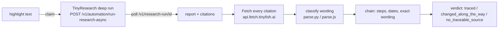

<div align="center">


# 🐟 Source Hunter

**A statistic gets repeated across a hundred articles, and nobody checks where it came from.** Highlight it, click once, and get the trail back to the original source — every step live, with the exact wording and a flag when the claim changed.

[](https://python.org/)
[](https://tinyfish.ai/)
[](https://github.com/Ehsas317/source-hunter/actions/workflows/ci.yml)
[](LICENSE)

TinyFish Student Bounty **Source Hunter** (Drop 002) · Browser Extension · **$100 / 400 pts win tier**

</div>

## 📑 Contents

- [🚀 Installing / Getting started](#-installing--getting-started)
- [🤖 How it works](#-how-it-works)
- [🛠 The trace: steps, verdicts, honesty](#-the-trace-steps-verdicts-honesty)
- [🧰 TinyResearch + Fetch: how each is used](#-tinyresearch--fetch-how-each-is-used)
- [✅ Demo: 5 real claims](#-demo-5-real-claims)
- [📁 Project structure](#-project-structure)
- [🤝 Contributing](#-contributing)
- [🔗 Links](#-links)
- [📜 Licensing](#-licensing)

## 🚀 Installing / Getting started

**As an extension (Chrome/Edge/Brave — or Firefox with MV3):**

```shell
git clone https://github.com/Ehsas317/source-hunter.git
cd source-hunter
```

1. Go to `chrome://extensions` → enable **Developer mode** → **Load unpacked** → pick the `extension/` folder.
2. Right-click the extension icon → **Options** → paste your TinyFish key (https://agent.tinyfish.ai/api-keys).
3. Highlight a statistic or quote on any page → click **🐟 Trace with TinyFish** → open the extension popup to watch the trace land (1–5 min; research deep mode runs in the background).

**As a CLI (same engine, same verdicts, for scripts and CI):**

```shell
pip install -r requirements.txt
export TINYFISH_API_KEY=...
source-hunter "Humans only use 10% of their brain" --output trace.json
make demo                     # re-run the 5-claim demo (~20 min, metered)
make test                     # 13 offline unit tests (no key needed)
```

## 🤖 How it works



The extension and the CLI share the same engine spec: Python package `sourcehunter/` and JS port `extension/lib/parse.js` produce **identical verdict names** (`matches`, `changed`, `not_found`, `no_source`; `traced`, `changed_along_the_way`, `no_traceable_source`).

## 🛠 The trace: steps, verdicts, honesty

Each citation in the chain is verified live by Fetch, then classified:

| Link status | Wording status | Step verdict | Meaning                                                     |
| ----------- | -------------- | ------------ | ----------------------------------------------------------- |
| dead        | —              | `no_source`  | page unreachable now                                        |
| live        | matches        | `matches`    | claim's numbers + vocabulary appear in the page's own words |
| live        | changed        | `changed`    | page talks about the claim but the numbers drifted          |
| live        | missing        | `not_found`  | live page, but no claim wording                             |

The **trace verdict** folds the chain: `traced` (any step matches) → `changed_along_the_way` (nothing matches but something changed) → `no_traceable_source` (nothing verifiable — said plainly, not dressed up).

**Earliest verifiable source** = oldest published live page carrying the claim's wording, with the exact quoted sentence. The research report's own origin markers ("first documented use...") are kept alongside (`report_markers`) so the human can judge both.

## 🧰 TinyResearch + Fetch: how each is used

- **TinyResearch (deep, $2/run)** does the tracing work: sub-questions, searches, reads up to ~30 pages, and returns the report + citation list. Remove it and the extension has no chain at all — this is the core dependency, not decoration.
- **Fetch** verifies each citation live: reachability, published date, and the exact wording sentence. Free within the daily allowance; this is where honesty is enforced (a dead link becomes `no_source`, not a claim).
- **Agent** was deliberately _not_ used per-citation: Fetch resolved every page; padding paid Agent calls would have inflated cost without changing a verdict. (The extension and CLI are ready to route JS-only pages to Agent if a site ever needs it.)

## ✅ Demo: 5 real claims

Run 2026-11-13 on this account (`$28.07 → $10.07` for the whole demo + tests ≈ $17.93, all in metered Research runs). Full artifacts: [`examples/`](examples/) (one JSON per claim + [`DEMO-REPORT.md`](examples/DEMO-REPORT.md)).

| #   | Claim                                          | Verdict                                 | What the trace found                                                                                                                                                                               |
| --- | ---------------------------------------------- | --------------------------------------- | -------------------------------------------------------------------------------------------------------------------------------------------------------------------------------------------------- |
| 1   | Humans only use 10% of their brain             | `changed_along_the_way` markers present | 1929 _World Almanac_ ad is the first documented "ten per cent" in print; William James' 1907 actual words were "only a small part" — **no percentage**; Einstein attribution has no archival basis |
| 2   | Napoleon was short                             | `traced`                                | Gillray cartoons + Histoire reports reached live primary/secondary pages; average height for his era (5'6" French), inches got "changed" in translation                                            |
| 3   | The Great Wall is visible from space naked-eye | `traced`                                | Smithsonian, Scientific American, Snopes (2001) all reached with exact wording; astronauts saw it from low orbit, not from the Moon                                                                |
| 4   | Carrots improve your eyesight                  | `traced`                                | Smithsonian + carrotmuseum + Snopes (2005) reached with exact wording; WWII radar propaganda origin                                                                                                |
| 5   | Einstein published E=mc² in 1905               | `traced`                                | reaches the 1905 _Annalen der Physik_ primary paper record — a real primary source with exact wording                                                                                              |

Note on claim 1: the _claim is wrong_ — and the trace shows **where it changed**: James' qualitative words (1907) → 1929 advertising percentage → 1936 Carnegie misattribution. The chain's `changed` steps are that drift, evidenced.

## 📁 Project structure

```
sourcehunter/          # CLI engine (pip-installable)
├── api.py             # run-research-async + poll + fetch-verify clients
├── parse.py           # keywords, numbers, exact wording, markers
├── trace.py           # research -> verify -> chain orchestrator
├── states.py          # verdict machine (explicit)
├── demo.py            # the 5-claim demo runner
├── cli.py             # `source-hunter "claim"`
extension/             # MV3 browser extension (load unpacked)
├── manifest.json
├── content.js         # highlight -> floating trace button
├── background.js      # research + verify + chain, same logic as trace.py
├── popup.html/js      # the trace UI
├── options.html/js    # API key (chrome.storage.sync)
├── lib/parse.js       # verdict-machine port, identical names
tests/                 # 13 offline tests
examples/              # 5 real traces + demo report
```

## 🤝 Contributing

Issues and PRs welcome. Verdict changes go in `sourcehunter/states.py` **and** the mirrored `extension/lib/parse.js`, with a test on both sides.

## 🔗 Links

- Repository: https://github.com/Ehsas317/source-hunter
- Demo transcripts: [examples/](examples/)
- TinyFish docs: https://docs.tinyfish.ai · API keys: https://agent.tinyfish.ai/api-keys

## 📜 Licensing

MIT — see [`LICENSE`](LICENSE).

---

<p align="right"><a href="#contents">Back to top ↑</a></p>
